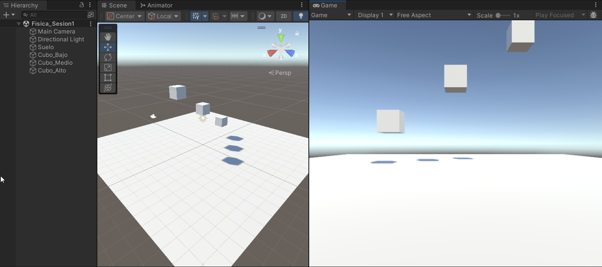
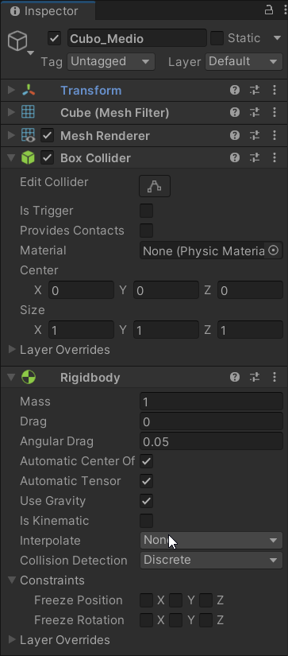
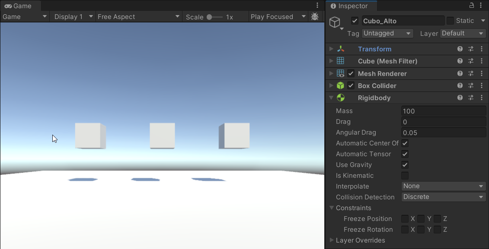
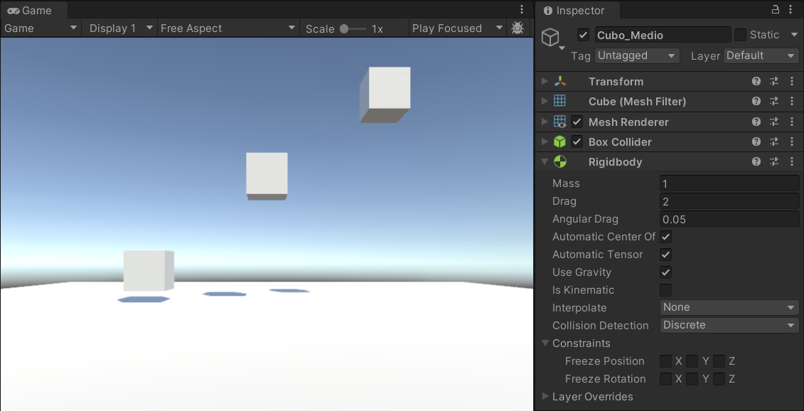
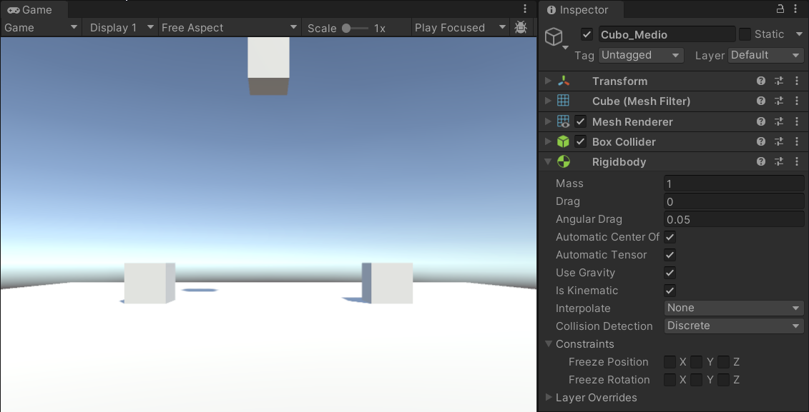
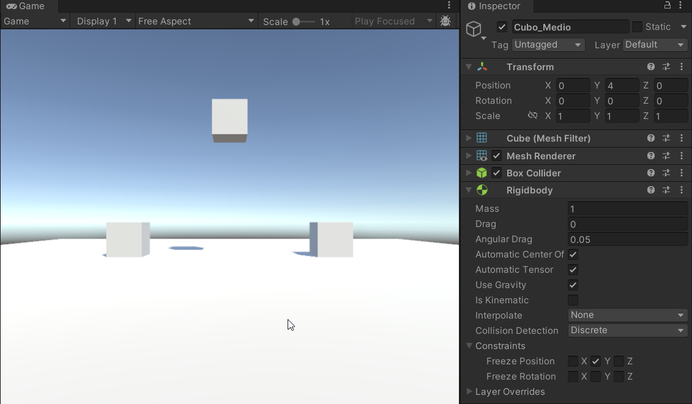

## Desarrollo

### Escena de caída

Creé un proyecto en Unity llamado Practica_Fisica1_RM con la escena *Fisica_Sesion1*. En ella agregué un plano llamado *Suelo*, que ya trae su Collider, y tres cubos a diferentes alturas: *Cubo_Bajo*, *Cubo_Medio* y *Cubo_Alto*. Al darle Play sin Rigidbody, los cubos se quedaron flotando.

*El suelo y los tres cubos a diferentes alturas.*

### Rigidbody y gravedad

A los tres cubos les agregué un Rigidbody con la gravedad activada. Al darle Play cayeron y se quedaron sobre el suelo. Llegaron en el orden de su altura: primero el bajo, luego el medio y al final el alto.

*Rigidbody de Cubo_Medio con sus valores iniciales.*

### Masa

Para comparar, puse los tres cubos a la misma altura y les di masas de 1, 10 y 100. Al darle Play, los tres cayeron al mismo tiempo.

*Los tres cubos cayendo juntos; Cubo_Alto tiene una masa de 100.*

### Drag

Regresé la masa a 1 y les di un Drag de 0, 2 y 10. El cubo sin Drag cayó normal, el de Drag 2 cayó más lento y el de Drag 10 bajó muy despacio.

*Cada cubo va a una altura distinta según su Drag; Cubo_Medio tiene un Drag de 2.*

### Is Kinematic

Regresé el Drag a 0 y activé Is Kinematic solo en *Cubo_Medio*. Los otros dos cayeron, pero *Cubo_Medio* se quedó fijo en su lugar aunque tenía la gravedad activada.

*Cubo_Medio se queda arriba con Is Kinematic activado.*

### Constraints

También probé las Constraints: en *Cubo_Medio* activé Freeze Position en Y. Al darle Play, los otros dos cayeron y él se quedó a su altura.

*Cubo_Medio no cae porque su posición en Y está bloqueada.*

Al final regresé los cubos a sus alturas originales con sus valores iniciales y guardé la escena.

## Preguntas de comprobación

**1. ¿Cuál es la diferencia entre Collider y Rigidbody?**
El Collider le da forma al objeto para que otros puedan chocar con él. El Rigidbody es el que hace que el objeto caiga y se mueva. Por eso los cubos sin Rigidbody se quedaron flotando, y el suelo, que solo tiene Collider, no se cae pero los cubos sí se detienen al llegar a él.

**2. ¿Qué ocurre al activar Is Kinematic?**
El objeto se queda quieto, aunque tenga la gravedad activada. Así pasó con *Cubo_Medio*.

**3. ¿La masa cambia la velocidad de caída?**
No. Los tres cubos tenían masas de 1, 10 y 100 y cayeron al mismo tiempo.

**4. ¿Para qué sirven las Constraints?**
Para que el objeto no se mueva o no gire en el eje que se elija. Al bloquear el eje Y, *Cubo_Medio* ya no cayó.

## Lo que observé y aprendí

Un objeto solo cae si tiene Rigidbody. La masa no cambia qué tan rápido cae, por eso los cubos llegaron al suelo según su altura. Con el Drag los cubos caen más lento. Con Is Kinematic el cubo se queda quieto, y con las Constraints se bloquea el movimiento solo en el eje que se elija.
