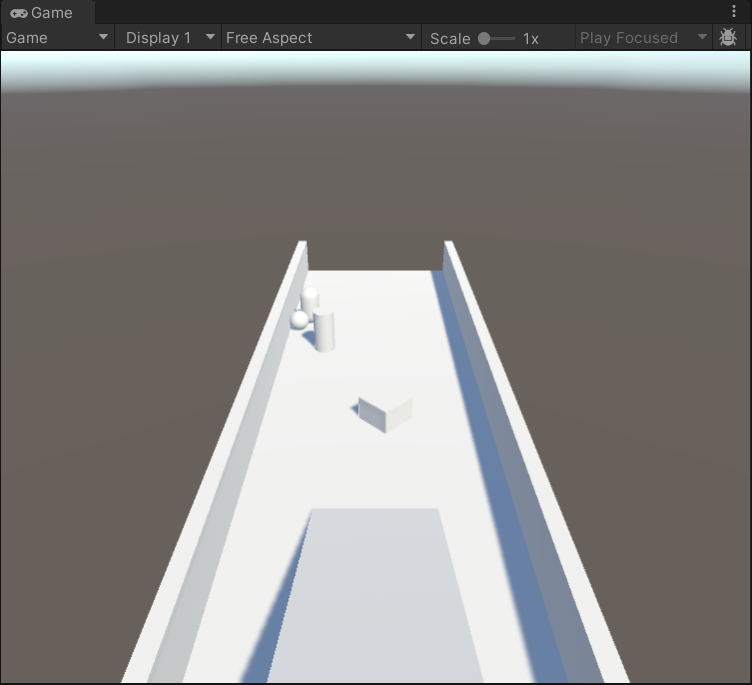
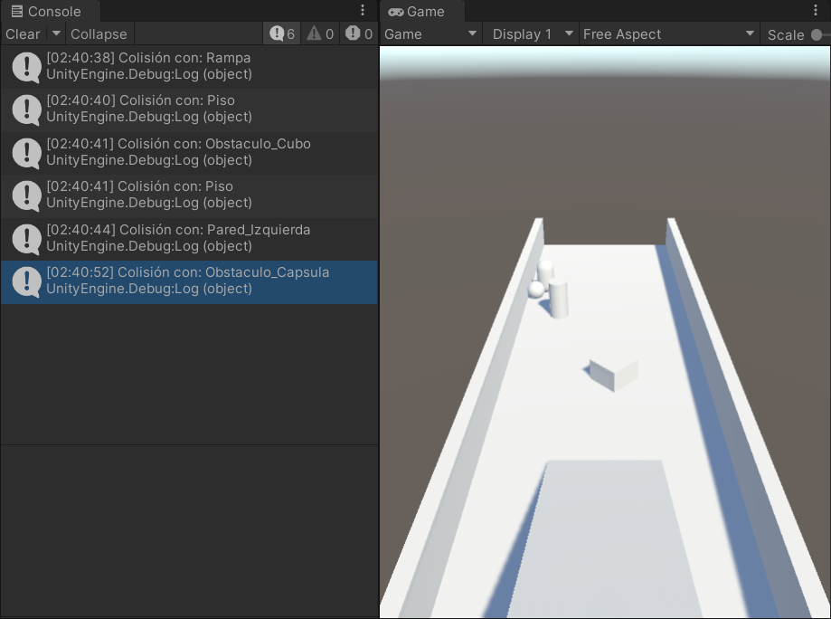
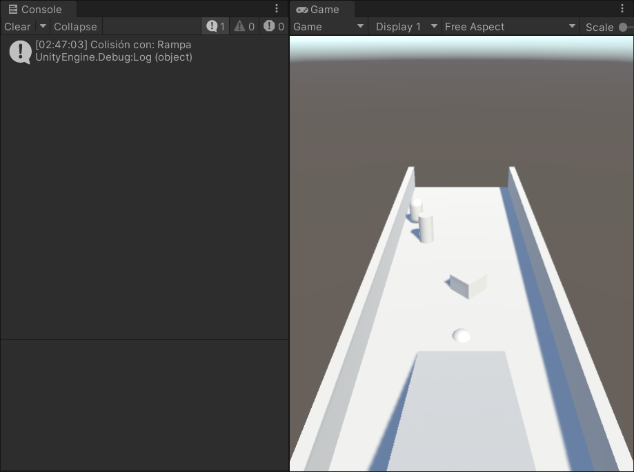
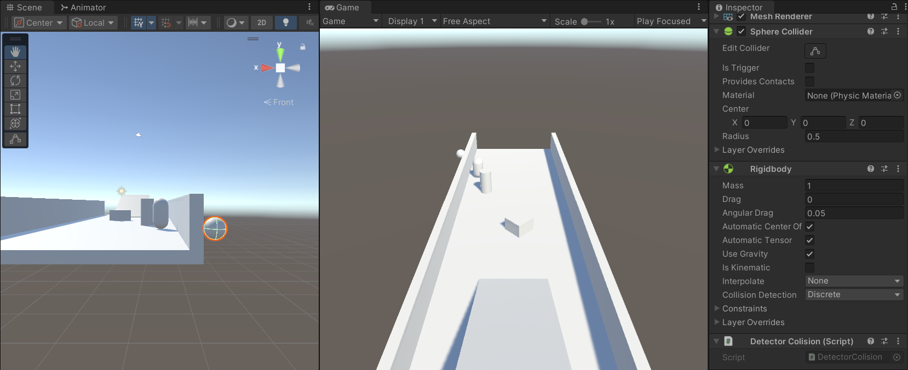
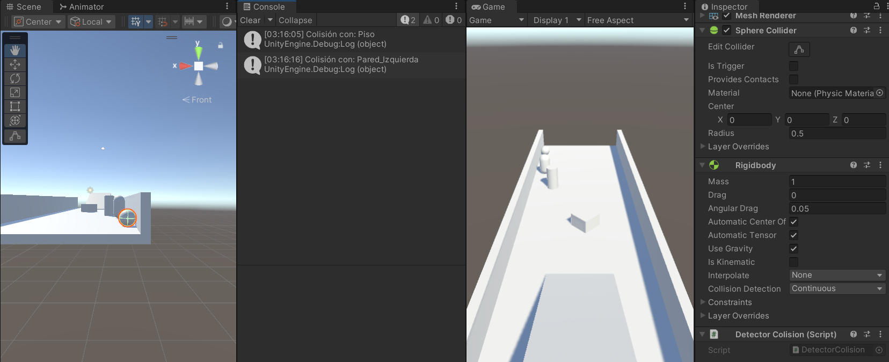

## Desarrollo

### Pista con obstáculos

Creé un proyecto en Unity llamado Practica_Fisica2_RM con la escena *Fisica_Sesion2*. En ella armé una pista con un piso, una rampa inclinada al inicio y dos paredes a los lados. Sobre el piso puse tres obstáculos: un cubo girado, un cilindro y una cápsula. Arriba de la rampa agregué una pelota con su Sphere Collider y un Rigidbody.

Todos los objetos tienen su Collider. El piso, la rampa, las paredes y el cubo usan Box Collider, y el cilindro y la cápsula usan Capsule Collider. Solo la pelota tiene Rigidbody, porque es lo único que se mueve.

Al darle Play, la pelota bajó por la rampa y chocó con el cubo, que la desvió hacia la izquierda. Después rebotó en la pared izquierda y siguió hasta chocar con la cápsula, donde se detuvo.

*La pista con la rampa, las paredes y los tres obstáculos; la pelota terminó junto a la cápsula.*

### Detección de colisiones con C#

Creé el script *DetectorColision* y se lo agregué a la pelota. Cada vez que la pelota choca con algo, escribe en la consola el nombre de ese objeto. Al darle Play aparecieron, en orden, los choques con la rampa, el piso, el cubo, la pared izquierda y la cápsula. El piso sale dos veces porque la pelota rebotó y lo volvió a tocar.

*La consola con cada choque de la pelota durante su recorrido.*

### Prueba sin el Collider del piso

Desactivé el Collider del piso y le di Play. La pelota bajó la rampa, pero al llegar al piso lo atravesó y siguió cayendo. En la consola solo apareció el choque con la rampa. Al terminar volví a activar el Collider.

*Sin Collider, la pelota se hunde en el piso y solo se registra el choque con la rampa.*

### Discrete y Continuous

Probé las dos formas que tiene Unity de detectar los choques: Discrete, que es la que viene por defecto, y Continuous, que sirve para objetos que van muy rápido. Para que la pelota fuera muy rápido, creé el script *ImpulsoInicial*, que le da una velocidad de 150 hacia la pared izquierda, y puse la pelota sobre el piso, al fondo de la pista.

Con Discrete, la pelota atravesó la pared y en la consola no apareció el choque.

*Con Discrete, la pelota quedó del otro lado de la pared izquierda.*

Con Continuous, la pelota se quedó junto a la pared y en la consola sí apareció el choque.

*Con Continuous, la pelota se queda en la pared y se registra el choque.*

Al final regresé la pelota a la parte alta de la rampa, dejé la detección en Discrete y guardé la escena.

## Video

## Lo que observé y aprendí

Sin Collider, un objeto se sigue viendo, pero los demás lo atraviesan, como pasó con el piso. Con *OnCollisionEnter* pude ver en la consola con qué chocaba la pelota. Con Discrete, la pelota muy rápida atravesó la pared sin que se detectara el choque, y con Continuous sí se detectó. Para algo lento, como la pelota bajando la rampa, basta con Discrete.
