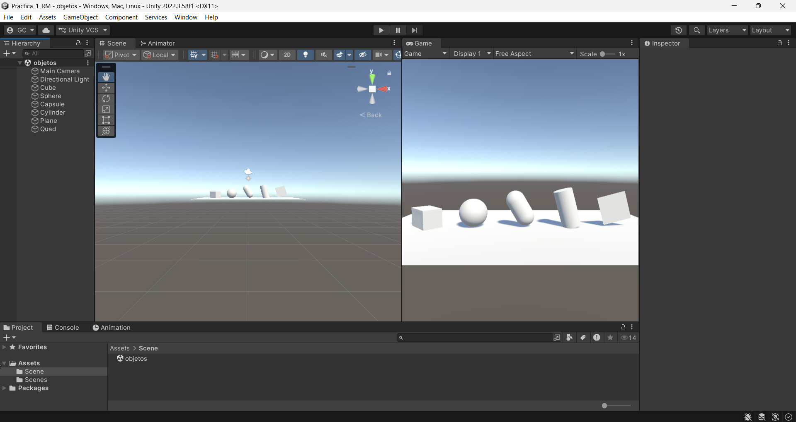
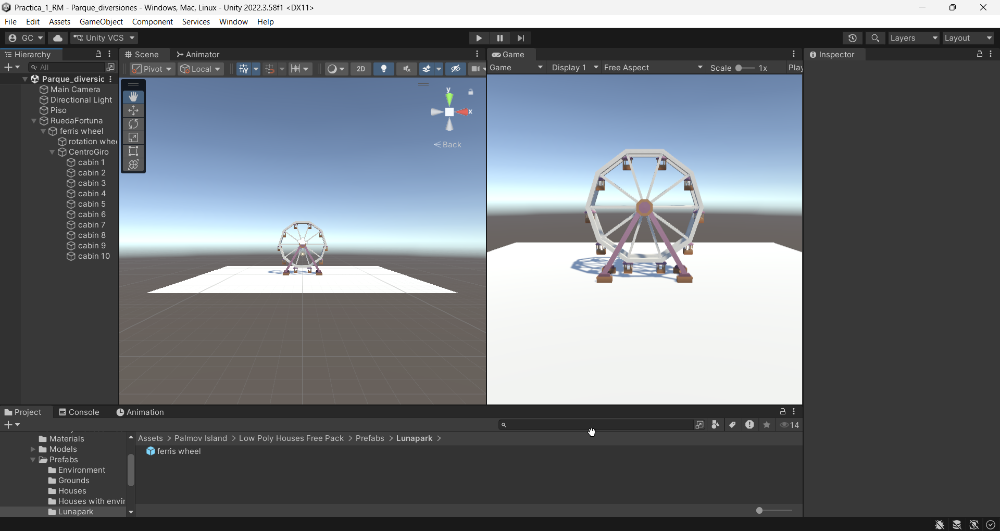
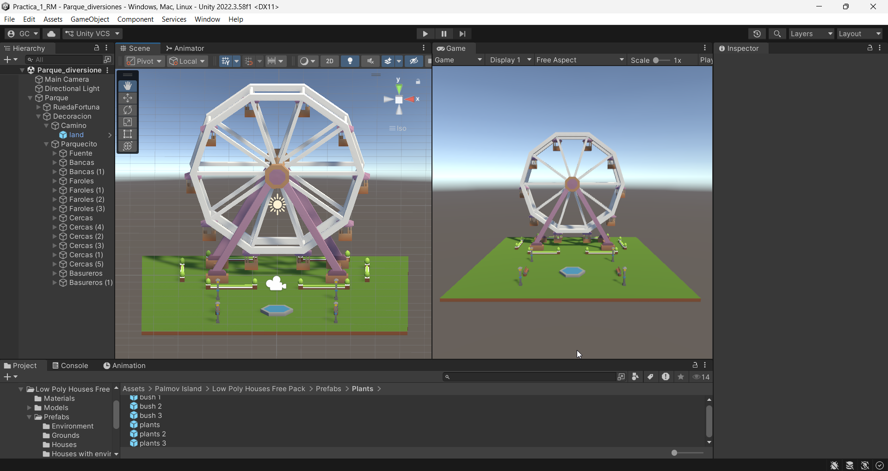

## Desarrollo

### Figuras geométricas

Creé un proyecto nuevo en Unity llamado *Practica_1_RM* y, dentro de la carpeta *Scene*, creé la escena *objetos*. En ella agregué las figuras geométricas que ofrece Unity (cubo, esfera, cápsula, cilindro, plano y quad), modifiqué su Transform y las acomodé en fila: a todas les cambié la posición y a algunas las giré.

### Parque de diversiones

Creé la escena *Parque_diversiones* y usé el paquete gratuito *Low Poly Houses Free Pack* de la Asset Store, que incluye una rueda de la fortuna. Agrupé el aro y las cabinas de la rueda dentro de un objeto vacío en su centro, para que en la siguiente práctica giren juntos. Después decoré el parque con pasto, una fuente, bancas, faroles, botes de basura y arbustos, y coloqué todo dentro de un objeto padre llamado *Parque* para ajustar su tamaño.

## Capturas

*Escena «objetos» con las seis figuras geométricas.*

*Rueda de la fortuna y su jerarquía.*

*Parque de diversiones decorado.*

## Video

## Propuesta de proyecto final

Mi proyecto final es una aplicación de realidad mixta para Meta Quest 3 que muestra una red inalámbrica sobre el espacio real.

- **GameObjects:** el router, los dispositivos conectados y los puntos donde se mide la señal.
- **Jerarquía:** un objeto *Red* que contenga al router, los dispositivos y las mediciones; cada dispositivo tendría como hijos su línea de conexión y su etiqueta.
- **Prefabs:** uno para los dispositivos y otro para los puntos de medición.

Es una propuesta inicial que puede cambiar durante el desarrollo.

## Lo que observé y aprendí

Todo objeto en Unity tiene un Transform que define su posición, rotación y tamaño. En una jerarquía, lo que le pasa al objeto padre les pasa también a sus hijos: si se mueve, gira o cambia de tamaño, los hijos lo siguen. Los prefabs son objetos que se pueden reutilizar, y todas sus copias dependen del original.
