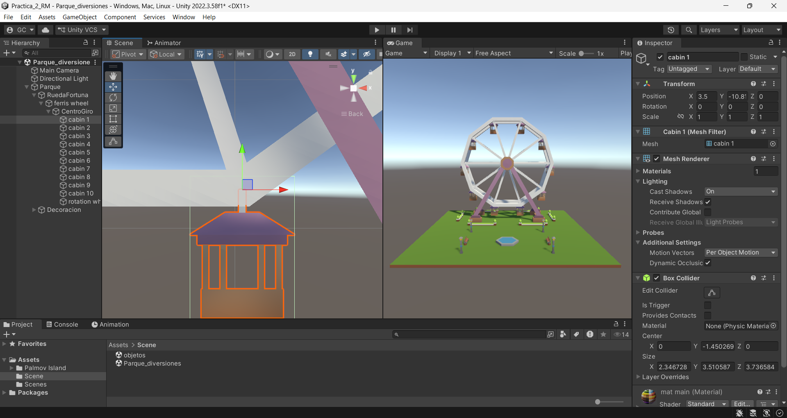
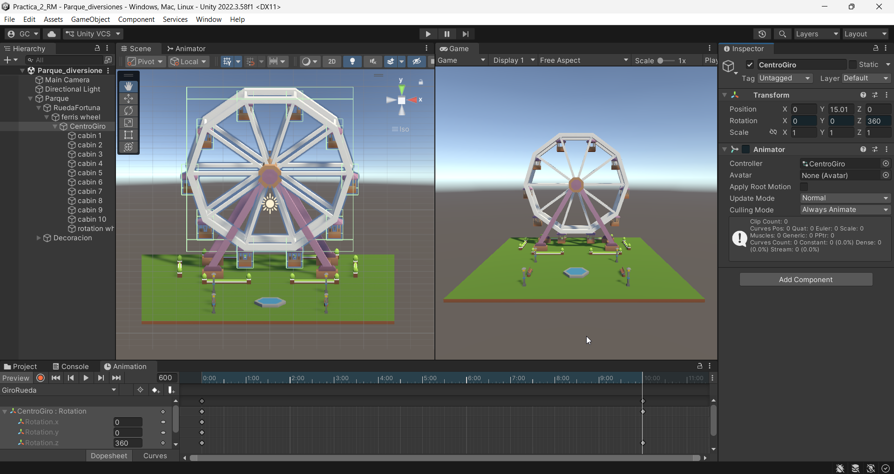
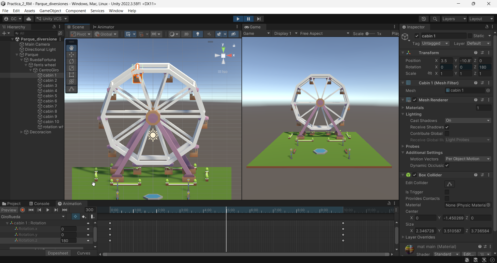
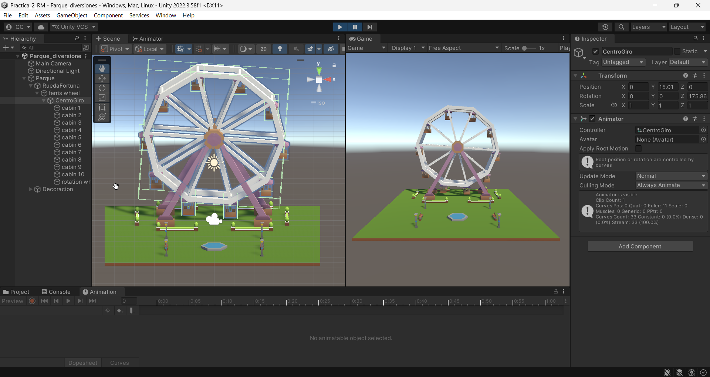

## Desarrollo

### Pivotes

Revisé en dónde estaba el pivote de las canastas de la rueda de la fortuna y vi que se encontraba en el punto donde cada una se sujeta a la rueda, por lo que no fue necesario crear pivotes nuevos. La rueda gira sobre el GameObject *CentroGiro*, ubicado en el centro de la rueda, que contiene la rueda y las diez canastas.

*Canasta seleccionada, con su pivote en el punto donde se sujeta a la rueda.*

### Animación de la rueda

Con la ventana Animation creé la animación *GiroRueda* sobre *CentroGiro* y le agregué dos keyframes en su rotación en Z: 0° al inicio y 360° a los 10 segundos, para que la rueda dé una vuelta completa.

*Keyframes de la rotación de CentroGiro.*

### Animación de las canastas

En la misma animación agregué la rotación de las diez canastas, de 0° a −360° en los mismos 10 segundos. Como las canastas están dentro de *CentroGiro*, giran junto con la rueda y se irían volteando. Para evitarlo, las hice girar al revés al mismo tiempo que la rueda, y así se quedan colgando.

*Keyframes de la rotación de las canastas.*

### Resultado

Al darle Play, la rueda gira sin detenerse y las canastas se quedan derechas todo el tiempo.

*La rueda a media vuelta, con las canastas colgando.*

*La rueda en otro momento del giro.*

## Lo que observé y aprendí

En la ventana Animation se ponen keyframes con el valor de un objeto en distintos momentos, y Unity hace el movimiento entre uno y otro. En una sola animación se puede mover un objeto y también a sus hijos. Las canastas giran con la rueda porque son sus hijas, así que para que se queden colgando hay que girarlas al revés y al mismo ritmo. También vi que el pivote es el punto sobre el que gira un objeto, por eso en las canastas tiene que estar donde se sujetan a la rueda.
