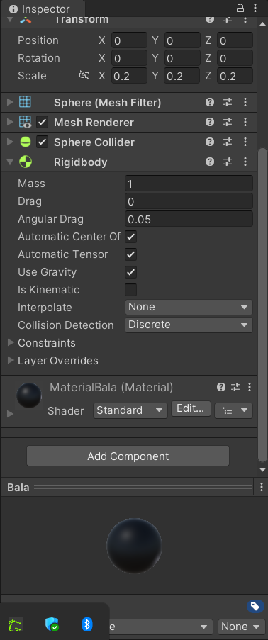
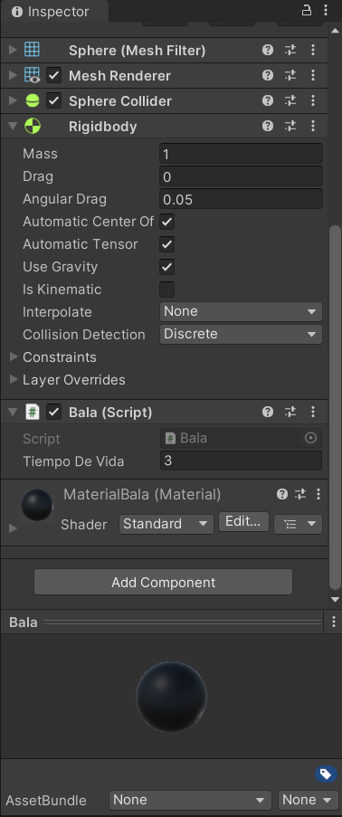
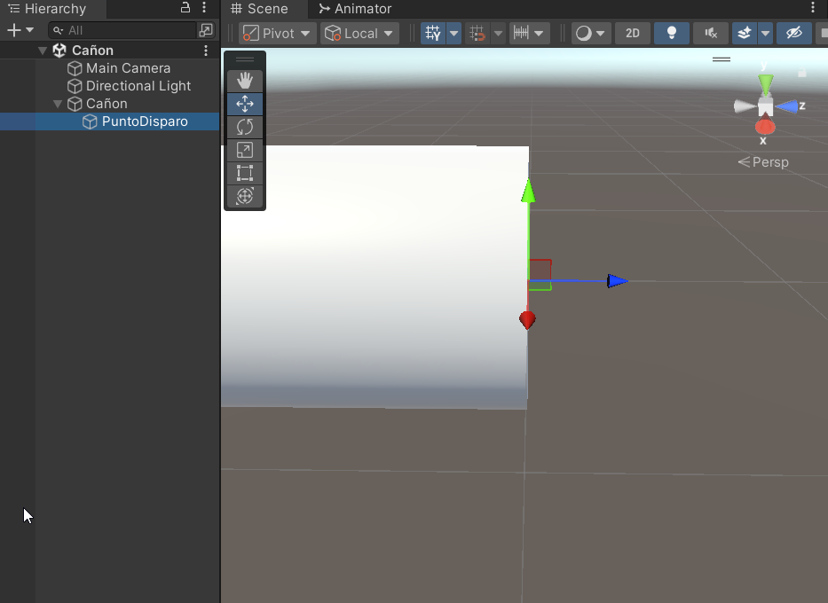
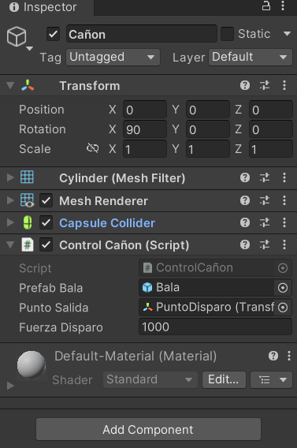
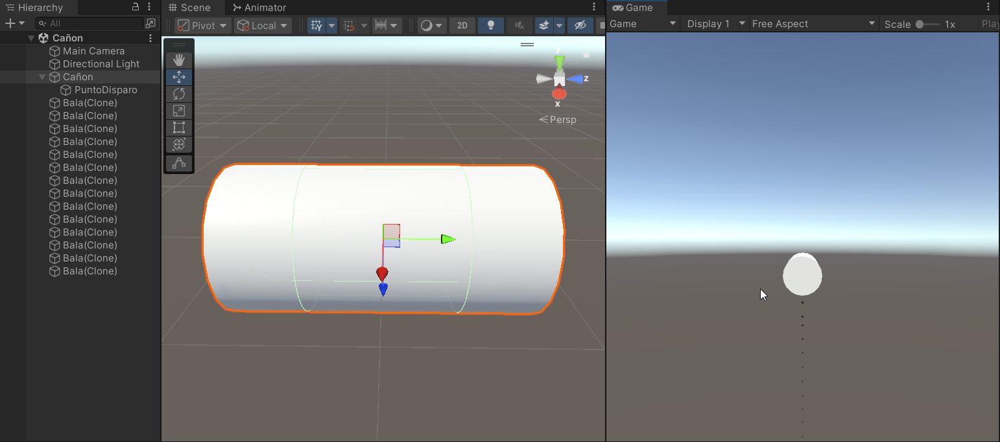

## Desarrollo

### Prefab de la bala

Creé un proyecto en Unity llamado Practica_3_RM con la escena *Cañon*. En ella agregué una esfera con escala de 0.2, le puse un Rigidbody y un material y le asigné un color negro. Después este lo convertí en un prefab y la borré de la escena, la bala se quedó en los archivos del proyecto.

*Prefab Bala con su escala, su Rigidbody y su material.*

### Script de la bala

Creé el script *Bala*, que borra la bala 3 segundos después de que aparece, y se lo agregué al prefab. El tiempo se puede cambiar desde el Inspector con la variable *Tiempo De Vida*.

*Componente Bala en el prefab, con un tiempo de vida de 3 segundos.*

### Cañón y punto de disparo

Agregué un cilindro llamado *Cañon* y lo giré 90° en X para que apuntara al frente. Dentro de él creé un objeto llamado *PuntoDisparo* y lo puse en la boca del cañón, para que las balas salgan desde ahí. Como es hijo del cañón, heredaba su giro y su eje Z apuntaba hacia abajo, así que lo giré −90° en X para que apuntara al frente.

*PuntoDisparo en la boca del cañón, con su eje Z (flecha azul) hacia el frente.*

### Script del cañón

Creé el script *ControlCañon* y se lo agregué al cañón. Cada vez que hago clic, crea una bala en *PuntoDisparo* y la empuja hacia el frente. En el Inspector le asigné el prefab de la bala, el *PuntoDisparo* y una fuerza de disparo de 1000.

*Componente ControlCañon con la bala, el punto de salida y la fuerza asignados.*

### Resultado

Al darle Play y hacer clic, las balas salen disparadas del cañón y van cayendo por la gravedad. Cada una aparece en la Hierarchy como *Bala(Clone)* y desaparece a los 3 segundos.

*Balas disparadas en la vista Game y sus copias en la Hierarchy.*

## Video

<iframe class="video" src="https://www.youtube.com/embed/LWDOc8Dc4p8" title="Práctica 3 · Cañón autónomo" allow="accelerometer; clipboard-write; encrypted-media; gyroscope; picture-in-picture" allowfullscreen></iframe>

## Lo que observé y aprendí

Un prefab funciona como una copia o clon. En la práctica, la bala solo existe en los archivos del proyecto y el script crea una copia nueva con cada disparo. Con el Rigidbody la bala responde a la física, por eso sale con el empujón del script y cae por la gravedad. Al borrar cada bala después de un tiempo, no se van acumulando en la escena. Las variables públicas aparecen en el Inspector, así que pude asignar la bala y el punto de disparo y cambiar la fuerza sin tocar el código. También vi que un objeto hijo hereda la rotación de su padre, por eso tuve que girar *PuntoDisparo* para que las balas salieran hacia el frente.
