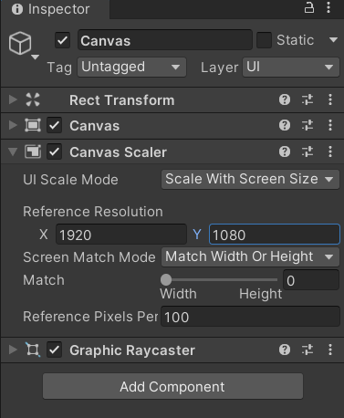
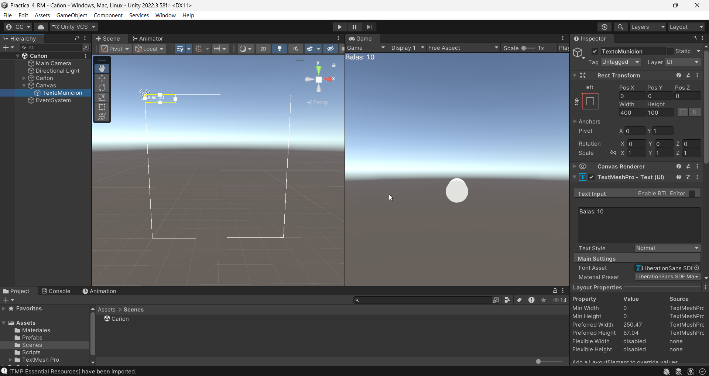
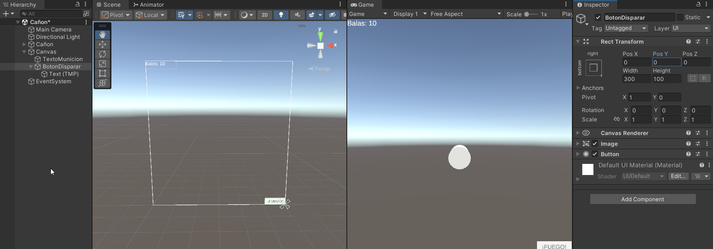
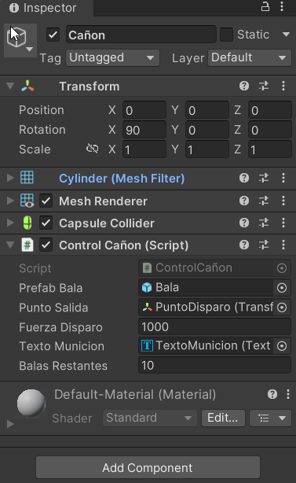
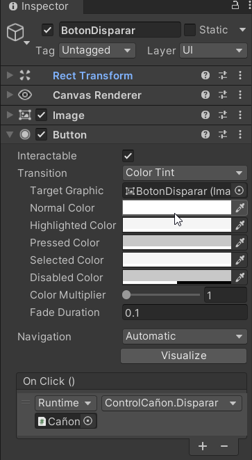
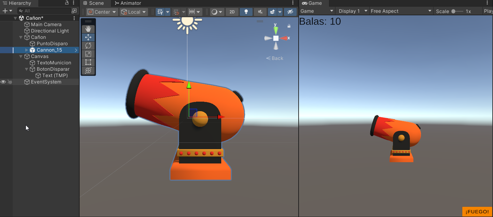
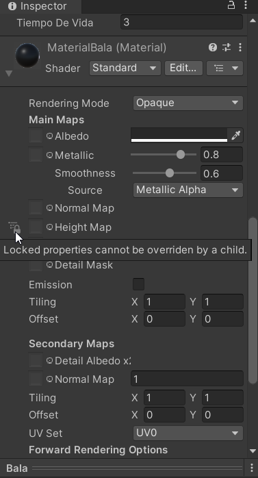
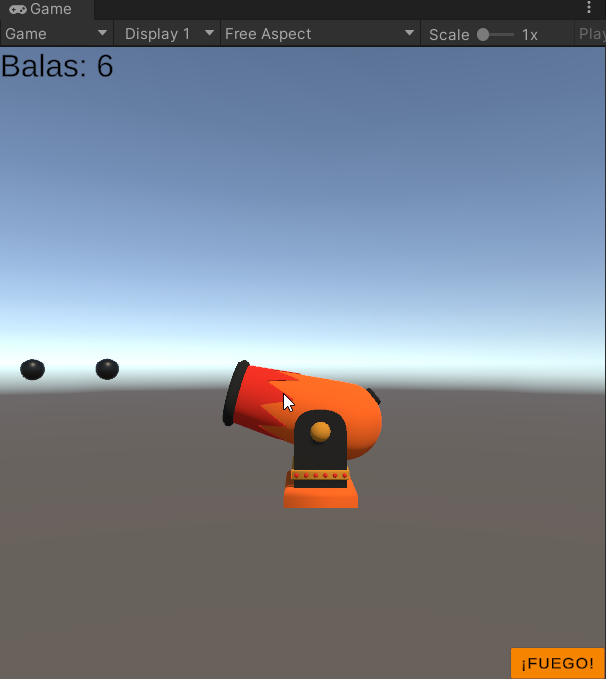
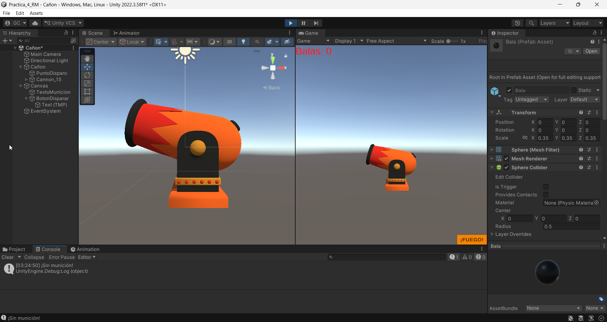

## Desarrollo

### Canvas

Agregué un Canvas a la escena del cañón. En su Canvas Scaler cambié el modo a *Scale With Screen Size* con una resolución de referencia de 1920 × 1080, para que la interfaz se ajuste al tamaño de la pantalla. Al crear el Canvas, Unity agregó también el EventSystem, que es el que recibe los clics en la interfaz.

*Canvas Scaler con la resolución de referencia de 1920 × 1080.*

### Contador de balas

Dentro del Canvas agregué un texto de TextMeshPro llamado *TextoMunicion*, lo anclé a la esquina superior izquierda y le escribí «Balas: 10» con tamaño 60.

*TextoMunicion anclado arriba a la izquierda.*

### Botón de disparo

Agregué un botón llamado *BotonDisparar*, lo anclé a la esquina inferior derecha y cambié su texto a «¡FUEGO!».

*BotonDisparar anclado abajo a la derecha.*

### Script del cañón

Modifiqué el script *ControlCañon* para que lleve la cuenta de las balas. Ahora empieza con 10, resta una con cada disparo y actualiza el texto. Cuando se acaban, ya no dispara y muestra «¡Sin munición!» en la consola. También hice pública la función *Disparar* para que el botón la pueda usar. En el Inspector le asigné el texto *TextoMunicion*.

*ControlCañon con el texto del contador asignado.*

### Conexión del botón

En el evento *On Click* del botón agregué el cañón y elegí la función *Disparar*, para que cada clic en «¡FUEGO!» dispare una bala.

*On Click del botón llamando a ControlCañon.Disparar.*

### Mejoras de diseño

Para mejorar el diseño de la práctica hice estos cambios:

- Cambié el cilindro por un modelo de cañón de la Asset Store.
- Cambié el aspecto de la bala.
- Le puse colores al botón, que cambian al pasar el mouse y al presionarlo.
- Cambié el color del contador y lo hice ponerse rojo cuando quedan 3 balas o menos.
- Agregué el disparo con la barra espaciadora.

*Modelo nuevo del cañón.*

*Material de la bala.*

### Resultado

Al darle Play, cada disparo con la barra espaciadora o con el botón saca una bala por la boca del cañón y el contador baja. Al llegar a 0, el texto queda en rojo, el cañón ya no dispara y aparece «¡Sin munición!» en la consola.

*Balas disparadas y el contador bajando.*

*Contador en 0, en rojo, y el mensaje «¡Sin munición!» en la consola.*

## Video

<iframe class="video" src="https://www.youtube.com/embed/h9wMV5q5WDU" title="Práctica 4 · Controlar el cañón" allow="accelerometer; clipboard-write; encrypted-media; gyroscope; picture-in-picture" allowfullscreen></iframe>

## Lo que observé y aprendí

En el Canvas se colocan los textos y botones que aparecen en pantalla, por encima de lo que muestra la cámara, y con *Scale With Screen Size* se ajustan a cualquier tamaño de pantalla. Al anclar el texto y el botón a una esquina, se quedan en su lugar aunque cambie la pantalla. El EventSystem es necesario para que los botones respondan. También vi que un botón puede llamar a una función de un script desde su evento *On Click*, siempre que la función sea pública, y que el script puede cambiar lo que dice un texto de la interfaz; así el contador muestra cuántas balas quedan después de cada disparo.
